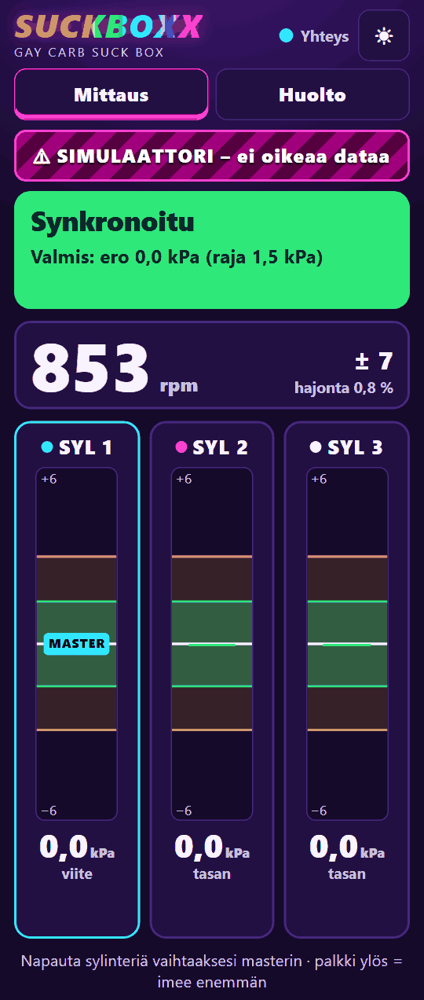
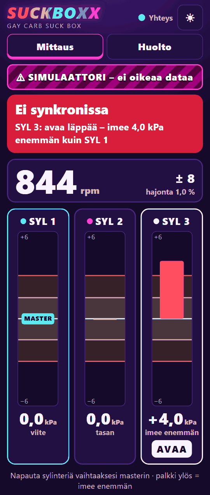
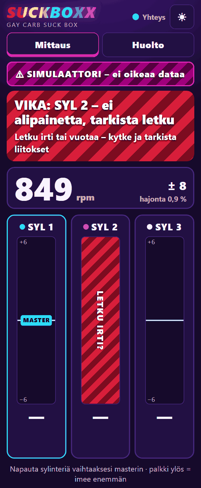
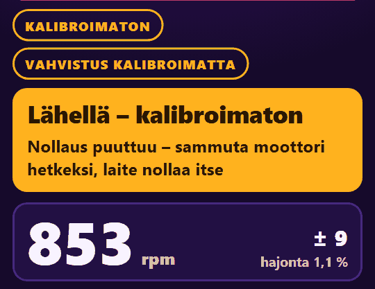
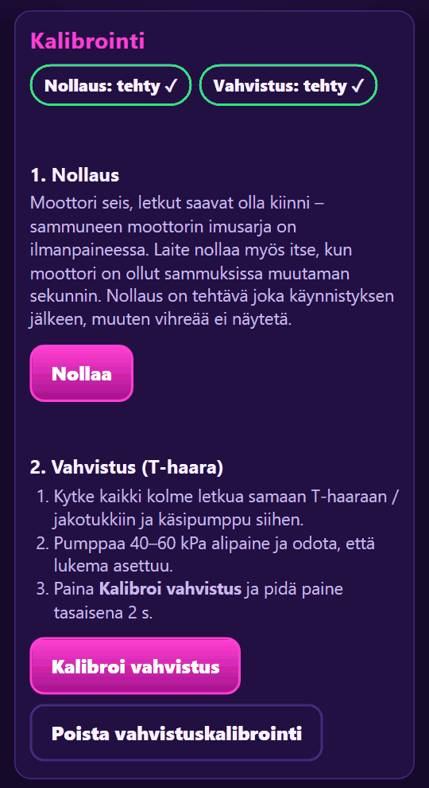

# Suckboxx: käyttöohje mekaanikolle

Suckboxx on kaasutinsynkronointimittari Honda BF50A -perämoottorille. Se mittaa kolmen sylinterin
imualipaineen ja näyttää puhelimessa, **mitä kaasutinta pitää säätää ja mihin suuntaan**.

Ohje vastaa laiteohjelmistoa ja web-käyttöliittymää 31.10.2026. Näytön tekstit on kopioitu
koodista (`firmware/src/core/status.h`, `web/index.html`). Jos ohje ja laite ovat eri mieltä,
laite on oikeassa. Päätösten perustelut ovat [SUUNNITTELU.md](../SUUNNITTELU.md):ssä (tunnukset
D1–D16, vaatimukset R1–R6, käytösmatriisi §8). Hondan arvot lähteineen ovat tiedostossa
[bf50a-huoltotiedot.md](bf50a-huoltotiedot.md) (verkosta 31.10.2026, ei korvaa Hondan
korjaamokäsikirjaa).

**Merkinnät**

- `koodifontti` = teksti täsmälleen niin kuin laite sen näyttää
- `N` ja `M` = sylinterin numero (1–3), `X` ja `Y` = laitteen näyttämä luku
- **(A)**, **(B)**, **(C)** = lähteen luotettavuus: Hondan aineisto, huoltolähde, foorumi
- **Varmistettava** = arvo, jota lähteistä ei löytynyt tai joka on vain B- tai C-tasoa. Se
  tarkistetaan Hondan käsikirjasta tai moottorilta eikä sitä arvata.

**Sisältö**

1. [Turvallisuus](#1-turvallisuus)
2. [Huolto-ohjeesta tarkistettavat](#2-huolto-ohjeesta-tarkistettavat)
3. [Pikaohje](#3-pikaohje)
4. [Kytkentä ja käynnistys](#4-kytkentä-ja-käynnistys)
5. [Mittausnäkymä](#5-mittausnäkymä)
6. [Synkronointi vaihe vaiheelta](#6-synkronointi-vaihe-vaiheelta)
7. [Tilat](#7-tilat)
8. [Kanavan tila](#8-kanavan-tila)
9. [Master-sylinteri](#9-master-sylinteri)
10. [Kalibrointi](#10-kalibrointi)
11. [Huoltosivu](#11-huoltosivu)
12. [Vianetsintä](#12-vianetsintä)

---

## 1. Turvallisuus

Lue tämä ennen jokaista käyttökertaa. Lähde: [moottoriajo.md](moottoriajo.md) §2.

> ⚠️ **Jäähdytysvesi.** Moottoria ei käytetä kuivana sekuntiakaan. Trailerilla tai telineessä
> huuhtelukupit paikalleen ja vesi auki **ennen** käynnistystä, tai moottori vedessä. Tarkista
> heti käynnistyksen jälkeen, että jäähdytysveden tarkkailusuihku virtaa. Jos se ei virtaa,
> sammuta heti.
>
> **Huuhtelukupeilla vain vapaalla ja tyhjäkäynnillä** (A): Hondan mukaan tyhjäkäyntiä suuremmat
> kierrokset voivat vaurioittaa vesipumppua ja ylikuumentaa moottorin. Korotetut kierrokset vain
> testisäiliössä tai vesillä.

> ⚠️ **Potkuri.** Vapaa-asento ennen käynnistystä ja koko työn ajan. Trailerilla potkuri on
> vapaana, eikä sen lähellä saa olla ketään. Vesillä vene kiinni laiturissa. Sammutusnaru
> (hätäkatkaisin) kiinni käyttäjään ja kokeiltu ennen käynnistystä.

> ⚠️ **Pakokaasu.** Moottoria käytetään vain ulkona, ei koskaan suljetussa tilassa.

> ⚠️ **Polttoaine ja polttoainehöyryt.** Ei avotulta, ei tupakointia, sammutin lähellä. Laite,
> puhelin, virtapankki ja kannettava ovat tavallista elektroniikkaa: pidä ne erillään
> polttoainesäiliöstä ja -letkuista. Synkronointitulppia ja letkunippoja vaihdetaan vain
> moottori sammuksissa.

**Pyörivät ja kuumat osat.** Synkronointi tehdään kansi auki, jolloin vauhtipyörä ja muut
pyörivät osat ovat paljaina. Reititä anturiletkut ja johdot nippusiteillä niin, etteivät ne osu
vauhtipyörään, vipuihin tai pakosarjan kuumiin osiin. Ei löysiä vaatteita, hihoja tai hiuksia.
Käytä kuulonsuojaimia.

**Merkitse ruuvit ensin.** Merkitse synkronointiruuvien alkuasento maalikynällä ennen kuin
käännät yhtäkään. Silloin alkuperäinen säätö voidaan aina palauttaa.

**Älä irrota letkua käyvästä moottorista.** Avoimen nipan tai letkun kautta imusarjaan pääsee
vuotoilmaa, ja joutokäynti muuttuu (moottoriajo.md §4, vaihe 11).

**Keskeytä**, jos tulppa ei irtoa, kierre ei täsmää, letku vuotaa (joutokäynti muuttuu letkua
kosketettaessa) tai jäähdytysvesi ei kierrä.

---

## 2. Huolto-ohjeesta tarkistettavat

Hondan arvot on haettu verkosta 31.10.2026 ja kirjattu lähteineen tiedostoon
[bf50a-huoltotiedot.md](bf50a-huoltotiedot.md) (D16). Ne eivät korvaa Hondan
korjaamokäsikirjaa. Viimeisen sarakkeen kohdat tarkistetaan ennen työtä.

| asia | lähteiden mukaan | varmistettava |
|---|---|---|
| Tyhjäkäyntikierrokset | **950 ± 50 rpm vapaalla** (A). Vaihteella Hondan arvoa ei löytynyt. | – |
| Mikä kaasutin on kiinteä perus (= master) | **alin kaasutin No. 3** (A + B). Laitteen oletus on SYL 3 (D7/D16). | ettei alimmassa kaasuttimessa ole synkronointiruuvia; laitteelta, että master on SYL 3 ([§9](#9-master-sylinteri)) |
| Mikä sylinteri on SYL 1 | No. 1 = ylin, No. 3 = alin kaasutin (päätelmä A + B -lähteistä: alin on perus ja perus on No. 3). Kytke SYL 1 ylimpään ja SYL 3 alimpaan. | osaluettelon "(CARBURETOR NO.)" |
| Säätöjärjestys | ensin No. 2, sitten No. 1; 1/8 kierrosta kerrallaan ja kaasu auki ja kiinni jokaisen säädön jälkeen (A + B) | – |
| Kumpaan suuntaan synkronointiruuvi avaa läppää | ei löytynyt: laite sanoo vain `AVAA` tai `SULJE` | käännä 1/8 kierrosta ja katso mittarista |
| Synkronointitulppa | 5 × 10 mm:n ristipääruuvi ja 5 mm:n tiiviste (B), eli M5, ei M6 | kierteen nousu (oletus M5×0,8) ennen nippojen tilausta |
| SE-letkut (rikastimen letkut kaasuttimien välillä) | puristetaan kiinni ennen mittausta (B) | sijainti ja puristuskohdat |
| Synkronoidaanko joutokäynnillä vai korotetulla joutokäynnillä | tyhjäkäynnillä ja aina samoilla kierroksilla, lämmitys noin 10 min (A + B). Laite antaa arvion välillä 500–3000 rpm (D12). | – |
| Saako huuhtelukupeilla ajaa korotetuilla kierroksilla | **ei**: kupeilla vain vapaalla ja tyhjäkäynnillä (A) | – |
| Synkronoinnin toleranssi | Hondan raja 20 mmHg ≈ 2,67 kPa (B). Laitteen oletus 1,5 / 3,0 kPa (D2), ks. [5.3](#53-värit-ja-toleranssi-d2). | – |

---

## 3. Pikaohje

1. Turvallisuus kunnossa (§1) ja ruuvien alkuasento merkitty.
2. Moottori sammuksissa: tulpat irti, nipat tilalle, letkut kiinni (SYL 1 = ylin kaasutin,
   SYL 3 = alin).
3. Laitteeseen virta USB-virtapankista. Puhelin Wi-Fi-verkkoon `Suckboxx` (salasana
   `alipaine123`), selaimella `http://192.168.4.1/`.
4. Tarkista, että yläreunassa **ei** lue `⚠ SIMULAATTORI – ei oikeaa dataa` ja että merkki
   `MASTER` on **SYL 3:n** kortissa ([§9](#9-master-sylinteri)).
5. Odota moottori sammuksissa noin 5 s, niin laite nollaa itsensä. Merkki `KALIBROIMATON`
   katoaa.
6. Jäähdytysvesi päälle, vapaa-asento, sammutusnaru kiinni. Käynnistä ja lämmitä moottori
   (noin 10 min). Sammuta, purista SE-letkut kiinni ja käynnistä uudelleen
   ([§6](#6-synkronointi-vaihe-vaiheelta)).
7. Lue banneri. Jos siinä lukee `Synkronoitu`, olet valmis. Muuten banneri ja sylinterikortti
   kertovat, minkä kaasuttimen läppää avataan (`AVAA`) tai suljetaan (`SULJE`).
8. Käännä ruuvia 1/8 kierrosta kerrallaan (ensin SYL 2, sitten SYL 1), avaa ja sulje kaasu, odota
   uutta tuomiota ja toista.

---

## 4. Kytkentä ja käynnistys

### 4.1 Letkut

- Käytä kolmea **identtistä** letkua: sama sisähalkaisija, sama pituus ±2 cm ja sama materiaali
  (R1). Pituusero näkyy kanavien välisenä erona, jota ohjelmisto ei voi korjata.
- Merkitse letkut SYL 1 / SYL 2 / SYL 3 ja kytke ne Hondan kaasutinnumeroiden mukaan: SYL 1 =
  ylin kaasutin (No. 1), SYL 3 = alin (No. 3) (A + B, [§2](#2-huolto-ohjeesta-tarkistettavat)).
- Synkronointitulppa on 5 × 10 mm:n ristipääruuvi ja 5 mm:n tiiviste (B). Nippa ja tiiviste
  tilalle vain moottori sammuksissa.
- Laite **liitäntöjä ylemmäs**, ja letkuun alaspäin osoittava lenkki ennen laitetta. Silloin
  kondenssi sekä polttoaine- ja öljysumu valuvat takaisin moottoriin eivätkä anturiin
  ([rauta.md](rauta.md) §4.4).
- Laitteen kotelo ei saa olla ilmatiivis (R5), joten älä teippaa sitä umpeen.

### 4.2 Virta ja yhteys

- Virta tulee USB:stä, esimerkiksi USB-virtapankista (D13).
- Yhdistä puhelin Wi-Fi-verkkoon **`Suckboxx`** salasanalla **`alipaine123`**. Laitteessa ei
  ole internetyhteyttä, ja puhelin voi huomauttaa siitä.
- Avaa selaimella **`http://192.168.4.1/`**. Laitteeseen voi olla yhteydessä enintään neljä
  puhelinta kerrallaan.
- Banneri näyttää aluksi `Odotetaan dataa…`, ja yläreunan yhteysvalo vaihtuu tekstistä
  `Yhdistetään…` tekstiin `Yhteys`.
- Jos yhteys katkeaa, näkymä harmaantuu ja näkyy `Ei yhteyttä laitteeseen`. **Harmaa näkymä on
  vanhaa dataa, joten älä säädä sen perusteella.** Yhteys palaa itsestään.

### 4.3 Simulaattori pois

Laitteessa on sisäinen moottorisimulaattori (D14). Kun se on käytössä, yläreunassa on
punaraidallinen palkki `⚠ SIMULAATTORI – ei oikeaa dataa`. **Kaikki luvut ovat silloin
keksittyjä.**

Jos palkki näkyy, avaa `Huolto` → `Asetukset` → ryhmä `Järjestelmä` →
`Signaalilähde (0 = simulaattori, 1 = ADC, 2 = HX710B)`. Valitse `ADC (XGZP)` ja paina
`Tallenna`. Laite kysyy `Signaalilähteen vaihto käynnistää laitteen uudelleen. Jatketaanko?`
ja käynnistyy uudelleen. Nollaus pitää tehdä sen jälkeen uudelleen ([10.1](#101-nollaus)).

Tämän ohjeen kuvat on otettu PC-simulaattorista, joten niissä palkki näkyy.

### 4.4 Nollaus ennen käynnistystä

Pidä moottori sammuksissa ja letkut kiinni, koska sammuneen moottorin imusarja on
ilmanpaineessa. Laite nollaa itsensä, kun banneri on näyttänyt `Ei alipainesignaalia` noin 3 s
ja lukemat ovat asettuneet. Mittausnäkymästä katoaa silloin merkki `KALIBROIMATON`, ja
huoltosivulla lukee `Nollaus: tehty ✓` ([10.1](#101-nollaus)).

### 4.5 Käynnistys

Kytke jäähdytysvesi päälle, varmista vapaa-asento ja kiinnitä sammutusnaru (§1). Käynnistä ja
tarkista tarkkailusuihku. Banneri vaihtuu järjestyksessä `Ei alipainesignaalia` →
`Odota, käynti tasaantuu` → tuomio. Synkronoi vasta lämpimällä moottorilla tasaisella
joutokäynnillä.

---

## 5. Mittausnäkymä

Näkymän osat ylhäältä alas:

| osa | mitä se kertoo |
|---|---|
| yhteysvalo | `Yhteys`, `Yhdistetään…` tai `Ei yhteyttä` |
| ☀-painike | `Päivänvalonäkymä`: vaalea teema kirkkaaseen aurinkoon |
| `Mittaus` / `Huolto` | välilehdet |
| varoitusmerkit | keltakehyksiset merkit, ks. [5.5](#55-varoitusmerkit) |
| banneri | tila (otsikko) ja neuvo; väri on laitteen tuomio |
| kierrosluku | iso rpm-luku, `± X` ja `hajonta X %` |
| sylinterikortit | `SYL 1`–`SYL 3`: palkki, ero masteriin kPa:na, säätöohje |
| `Aaltomuoto (3 s)` | kanavien painekäyrät viimeiseltä 3 sekunnilta |
| `Diagnostiikka` | avattava taulukko, ks. [12.1](#121-diagnostiikka) |

### 5.1 Ero masteriin (D3)

- Laite vertaa jokaisen sylinterin **keskimääräistä alipainetta syklin yli** (D1)
  master-sylinterin vastaavaan. Masterin kortissa on aina merkki `MASTER`, ja tuomion aikana
  siinä lukee `0,0 kPa` ja `viite`.
- Muiden korteissa ero näkyy etumerkillä:
  - `+X kPa` ja `imee enemmän`: alipaine on syvempi kuin masterissa, joten tämän kaasuttimen
    läppä on suljetumpi. Palkki nousee **ylös**.
  - `−X kPa` ja `imee vähemmän`: läppä on avoimempi. Palkki laskee **alas**.
  - `tasan`: ero on alle 0,05 kPa.
- Kun kierrosluku muuttuu säädön aikana, kaikkien sylinterien alipaine muuttuu yhdessä. Ero
  masteriin poistaa tämän yhteisen liikkeen, joten näet vain oman säätösi vaikutuksen.
- Korttien alla oleva vihje muistuttaa tästä:
  `Napauta sylinteriä kahdesti vaihtaaksesi masterin · palkki ylös = imee enemmän`.

### 5.2 Palkki ja asteikko

- Asteikko on kiinteä: ±2 × keltainen raja, eli oletuksin ±6 kPa. Raja-arvot näkyvät mittarin
  ylä- ja alanurkassa, joten palkin pituus tarkoittaa aina samaa.
- Jos ero menee asteikon yli, palkin päähän tulee nuoli ▲ tai ▼.
- Mittarissa on kaksi kaistaa: ulompi on keltainen raja (±3,0 kPa) ja sisempi vihreä raja
  (±1,5 kPa). Sisempi kaista muuttuu vihreäksi vain tilassa `Synkronoitu`.
- Palkin väri kertoo **tämän sylinterin** erosta masteriin: keltainen yli 1,5 kPa ja punainen yli
  3,0 kPa. Rajan sisällä palkki on vihreä vain tilassa `Synkronoitu` ja muuten neutraali.
- Palkit näkyvät vain, kun laite antaa tuomion ([7.3](#73-tuomio-vihreä-keltainen-punainen)).
  Muissa tiloissa kortissa on `—`.

### 5.3 Värit ja toleranssi (D2)

Tuomio lasketaan erojen hajonnasta: **spread = suurin ero − pienin ero**. Masterin 0 on mukana.

| spread | banneri |
|---|---|
| enintään 1,5 kPa | 🟢 `Synkronoitu` |
| 1,5–3,0 kPa | 🟡 `Lähellä` |
| yli 3,0 kPa | 🔴 `Ei synkronissa` |

Esimerkki: SYL 2 = +1,0 kPa ja SYL 3 = −1,0 kPa. Kumpikin on 1,5 kPa:n sisällä masterista,
mutta spread on 2,0 kPa, joten banneri on `Lähellä`. Palkit ovat neutraaleja, mutta banneri on
keltainen. **Bannerin väri ratkaisee:** palkin väri kertoo yhdestä sylinteristä, bannerin väri
koko moottorista.

Vihreä tuomio vaatii lisäksi seuraavat ehdot:

- Laite on nollattu sen jälkeen, kun se viimeksi käynnistyi (D11). Ilman nollausta tuomio on
  enintään keltainen, ja otsikon perässä lukee `– kalibroimaton`.
- Kierrosluku on 500–3000 rpm (D12), hajonta on enintään 15 %, ja käynti on ollut vakaa
  vähintään 3 s.
- Kaikki kolme kanavaa ovat kunnossa. Laite ei koskaan näytä vihreää, jos yksikin kanava on
  epäluotettava (SUUNNITTELU.md §8).

Rajat ovat lähtöarvoja. Ne säädetään huoltosivulla kentistä `Synkronoitu, kun ero enintään` ja
`Lähellä, kun ero enintään`, ja lopulliset arvot päätetään oikealta moottorilta nauhoitetun
datan perusteella (D2). Jos huolto-ohje antaa toleranssin elohopeamillimetreinä:
1 kPa ≈ 7,5 mmHg, joten 1,5 kPa ≈ 11 mmHg ja 3,0 kPa ≈ 22,5 mmHg. Hondan raja BF50A:lle on
20 mmHg ≈ 2,67 kPa (B): `Synkronoitu` täyttää sen aina, `Lähellä` vain alle 2,67 kPa:n
erolla (D2, D16).

### 5.4 Kierrosluku

- Iso luku on kierrosluku, joka lasketaan alipainepulsseista ilman erillistä anturia.
- `± X` on kierrosluvun vaihtelu syklistä toiseen (keskihajonta, rpm), ja `hajonta X %` on sama
  vaihtelu suhteessa kierroslukuun.
- Harmaa luku tarkoittaa, ettei kierrosluku ole vielä luotettava (`Odota, käynti tasaantuu` tai
  `Ei alipainesignaalia`). `—` tarkoittaa, ettei kierroslukua ole.
- Keltainen sykkivä kehys liittyy merkkiin `KIERROKSET MUUTTUVAT` ([5.5](#55-varoitusmerkit)).

### 5.5 Varoitusmerkit

Merkit näkyvät bannerin yläpuolella. Ne eivät vaihda otsikkoa (käytösmatriisin rivit 5, 10 ja
11 sekä D11).

| merkki | tarkoittaa | mitä teet |
|---|---|---|
| `KALIBROIMATON` | Nollaus puuttuu laitteen viimeisen käynnistyksen jälkeen (D11). Vihreää ei näytetä. | Sammuta moottori hetkeksi tai paina `Huolto` → `Nollaa` ([10.1](#101-nollaus)). |
| `VAHVISTUS KALIBROIMATTA` | Vahvistuskalibrointia ei ole tehty (rivi 11). Pelkkä varoitus, joten vihreä on sallittu. | Tee vahvistuskalibrointi, kun T-haara ja pumppu ovat käsillä ([10.2](#102-vahvistuskalibrointi-t-haara)). |
| `SATUROITUU` | Pulssin positiivinen huippu (paluuaalto) leikkautuu anturin ylärajaan (rivi 10, H1). Tuomio näytetään yhä, koska leikkautuminen on sama kaikissa kanavissa (D4). | Tallenna raakadata ([11.2](#112-raakadata)) ja kirjaa havainto. |
| `KIERROKSET MUUTTUVAT` | Kierrosluku on muuttunut yli 50 rpm 2 s:n aikana (rivi 5). Erot pysyvät näkyvissä. | Jatka säätöä, mutta anna kierrosten asettua ennen lopullista lukemaa. |

### 5.6 Aaltomuoto

`Aaltomuoto (3 s)` näyttää kolmen kanavan painekäyrät kPa:na. Käyrien värit ovat samat kuin
korttien pallojen värit. Painike `Asteikko: auto` vaihtaa kiinteään asteikkoon
`Asteikko: −100…+10`. Jos yksi käyrä on suora viiva muiden sykkiessä, letku on irti tai tukossa.

---

## 6. Synkronointi vaihe vaiheelta

1. Moottori on lämmin (noin 10 min) ja käy tasaista joutokäyntiä, **950 ± 50 rpm vapaalla** (A).
   Synkronoi aina samoilla kierroksilla. Näkymässä ei ole `VIKA`-banneria, merkkiä
   `KALIBROIMATON` eikä simulaattoripalkkia.
2. Tarkista, että master on **SYL 3** eli alin kaasutin, joka on kiinteä perus
   ([§9](#9-master-sylinteri)), ja että kaasuttimien väliset **SE-letkut** on puristettu kiinni
   (B). Purista ne moottori sammuksissa, ja käynnistä sitten uudelleen.
3. Odota tuomiota. Banneri `Odota, käynti tasaantuu` ja neuvo `Vakautta odotetaan: X / 3,0 s`
   laskevat vakaata aikaa.
4. Lue banneri:
   - `Synkronoitu`: valmis. Neuvo on `Valmis: ero X kPa (raja 1,5 kPa)`.
   - `Lähellä` tai `Ei synkronissa`: neuvo on muotoa
     `SYL N: avaa läppää – imee X kPa enemmän kuin SYL M` tai
     `SYL N: sulje läppää – imee X kPa vähemmän kuin SYL M`.
     Saman sylinterin kortti saa korostetun kehyksen ja tekstin `AVAA` tai `SULJE`.
5. Säädä **ensin SYL 2** (No. 2, perusta lähin) ja **sitten SYL 1** (No. 1), kuten Honda
   neuvoo (A + B). Masterissa (SYL 3) ei ole synkronointiruuvia. Laite nimeää bannerissa
   suurimman eron; jos se nimeää SYL 1:n, säädä silti ensin SYL 2:ta sen kortin luvun mukaan:
   `+X kPa` (imee enemmän) → avaa, `−X kPa` (imee vähemmän) → sulje. `AVAA` tarkoittaa, että
   tämän kaasuttimen läppää avataan hieman, ja `SULJE`, että sitä suljetaan.
   Käännä **1/8 kierrosta kerrallaan**, ja avaa ja sulje kaasu muutaman kerran jokaisen säädön
   jälkeen (A + B). **Kiertosuuntaa ei löytynyt lähteistä:** käännä ensimmäisellä kerralla
   1/8 kierrosta ja katso, kumpaan suuntaan ero muuttuu. Laite ei tiedä ruuvin kiertosuuntaa.
6. Odota noin 5 s. Säädön jälkeen voi hetken näkyä `Odota, käynti tasaantuu` (neuvona
   `Alipaine muuttuu kaikissa sylintereissä` tai vakausodotus) tai merkki
   `KIERROKSET MUUTTUVAT`. Lue sitten uusi tuomio.
7. Toista, kunnes banneri on `Synkronoitu`. Laite neuvoo kerrallaan sitä sylinteriä, jonka ero
   masteriin on suurin. Kun se on korjattu, neuvo voi siirtyä toiseen sylinteriin.
8. Tarkista lopuksi joutokäynti (950 ± 50 rpm vapaalla, A), koska kaasuttimien säätö muuttaa
   kierroslukua (SUUNNITTELU.md §3.4). Hondan raja kaasuttimien erolle on 20 mmHg ≈ 2,67 kPa
   (B): `Synkronoitu` (enintään 1,5 kPa) täyttää sen aina, `Lähellä` vain, jos `Ero (spread)`
   on alle 2,67 kPa.
9. Sammuta moottori. Poista SE-letkujen puristimet, irrota letkut ja kiinnitä tulpat ja
   tiivisteet vasta sen jälkeen.

---

## 7. Tilat

Banneri näyttää aina yhden tilan, ja laite valitsee sen kiinteässä järjestyksessä:
masterin vika → anturivika → letkuvika → ei signaalia → odotus → liian suuri kierrosluku →
tuomio. Viat voittavat siis aina säätötilat. Jos esimerkiksi master on vialla ja toisessa
kanavassa on anturivika, banneri näyttää masterin vian.

Otsikot (bannerin ylärivi) ovat alla täsmälleen niin kuin laite ne näyttää. Neuvorivi (bannerin
alarivi) tarkentaa syytä.

### 7.1 Viat (punaraidallinen banneri)

Palkit ja tuomio on piilotettu. Viallisen sylinterin korttiin tulee peite ([§8](#8-kanavan-tila)).

| otsikko | syy (käytösmatriisin rivi) | mitä teet |
|---|---|---|
| `Master (SYL N) ei kelpaa viitteeksi – valitse toinen` | Masterin oma kanava on vialla: anturivika, letku irti tai ei pulssia (rivi 12). Erot masteriin ovat silloin merkityksettömiä. | Korjaa masterin letku tai anturi, tai valitse toinen master ([§9](#9-master-sylinteri)). |
| `VIKA: SYL N – anturivika` | Anturin jännite on jumissa mittausalueen ääripäässä vähintään 1 s (rivi 7). Syynä on anturi irti, johto poikki tai oikosulku. | Tarkista anturin johdot ja liitokset tai vaihda anturi. |
| `VIKA: SYL N – ei alipainetta, tarkista letku` | Kanavassa ei ole pulssia ja paine on ilmanpaineessa (alle 2 kPa), vaikka muut sylinterit pulssivat. Tila on kestänyt vähintään 0,5 s (rivi 6). | Kytke letku ja tarkista nippa ja liitokset. |
| `VIKA: SYL N – ei pulssia, tarkista letku` | Kanavassa ei ole pulssia, mutta paine ei ole ilmanpaineessa. Tila on kestänyt vähintään 3 s (rivi 6, laajennus). | Letku on tukossa, taittunut tai irti. Tarkista koko letku. |
| `VIKA: SYL N ja SYL M – tarkista letkut` | Kahdessa kanavassa on letkuvika: toisessa ei ole alipainetta, toisessa ei pulssia. | Tarkista molemmat letkut. |

Jos vika on usealla kanavalla, otsikko luettelee ne kaikki, esimerkiksi
`VIKA: SYL 2 ja SYL 3 – ei alipainetta, tarkista letkut` tai `SYL 1, SYL 2 ja SYL 3`.

Neuvorivit:

| neuvo | otsikko, jonka alla se näkyy |
|---|---|
| `SYL N: anturivika (jännite X mV)` | master ei kelpaa |
| `SYL N: ei alipainetta – tarkista letku` | master ei kelpaa |
| `SYL N: ei pulssia (taso X kPa) – tarkista letku` | master ei kelpaa |
| `Jännite X mV – tarkista anturin johdot tai vaihda` | anturivika yhdessä anturissa |
| `Useita anturivikoja – tarkista anturien käyttöjännite` | anturivika usealla anturilla, todennäköisesti yhteisessä syötössä (anturien LDO, R6) |
| `Letku irti tai vuotaa – kytke ja tarkista liitokset` | ei alipainetta |
| `Taso X kPa ilman pulssia – letku irti, tukossa tai taittunut?` | ei pulssia |
| `Letku irti, vuotaa tai tukossa – tarkista liitokset` | tarkista letkut |

### 7.2 Odotus (harmaa banneri)

| otsikko | syy | mitä teet |
|---|---|---|
| `Ei alipainesignaalia` | Missään kanavassa ei ole pulssia: moottori on sammuksissa tai kaikki letkut ovat irti (rivit 1 ja 8, D10). Laite ei pysty erottamaan näitä toisistaan. Neuvo: `Moottori sammuksissa tai letkut irti`. | Käynnistä moottori tai kytke letkut. Kun moottori on sammuksissa, laite nollaa itsensä ([10.1](#101-nollaus)). |
| `Odota, käynti tasaantuu` | Käynti ei ole vielä mitattavissa (rivi 2). Syy näkyy neuvorivillä (alla). | Odota. |
| `Säädä joutokäynnillä` | Kierrosluku on yli 3000 rpm (rivi 9). Kierrosluku näkyy, mutta tuomio on piilotettu. Neuvo: `Kierrosluku X rpm (raja 3000) – laske kaasua`. | Laske kaasu joutokäynnille. |

Neuvorivit tilassa `Odota, käynti tasaantuu`:

| neuvo | tarkoittaa |
|---|---|
| `SYL N: ei pulssia (taso X kPa)` | Yhden kanavan pulssi katosi juuri. Jos tila jatkuu, siitä tulee `VIKA` (0,5 s tai 3 s, [7.1](#71-viat-punaraidallinen-banneri)). |
| `Kierroslukua ei vielä tunnistettu` | Pulsseja on, mutta jaksoja ei ole vielä riittävästi. |
| `Käynti epätasainen: hajonta X % (raja 15,0 %)` | Kierrosluku vaihtelee liikaa syklistä toiseen. |
| `Kierrosluku liian matala: X rpm (raja 500)` | Kierrosluku on alle 500 rpm, eli moottori on sammumassa (D12). |
| `Alipaine muuttuu kaikissa sylintereissä` | Kaikkien sylinterien alipaine liikkuu samaan suuntaan, esimerkiksi kaasun tai kuorman muuttuessa (rivi 5). Yhden ruuvin säätö ei aiheuta tätä. |
| `Vakautta odotetaan: X / 3,0 s` | Kaikki on kunnossa, ja laite odottaa 3 s vakaata käyntiä ennen tuomiota. |

### 7.3 Tuomio (vihreä, keltainen, punainen)

| otsikko | syy | mitä teet |
|---|---|---|
| 🟢 `Synkronoitu` | Spread on enintään 1,5 kPa ja nollaus on tehty (rivi 3). | Valmis. |
| 🟡 `Lähellä` | Spread on 1,5–3,0 kPa (rivi 4a). | Hienosäädä neuvon mukaan. |
| 🔴 `Ei synkronissa` | Spread on yli 3,0 kPa (rivi 4b). | Säädä neuvon nimeämää sylinteriä. |
| 🟡 `Lähellä – kalibroimaton` | Nollaus puuttuu (D11), ja spread on enintään 3,0 kPa. Ilman nollausta tuomio on enintään keltainen. | Nollaa ensin ([10.1](#101-nollaus)) ja säädä vasta sitten. |
| 🔴 `Ei synkronissa – kalibroimaton` | Nollaus puuttuu, ja spread on yli 3,0 kPa. | Nollaa ensin. |

Neuvorivit:

| neuvo | milloin |
|---|---|
| `SYL N: avaa läppää – imee X kPa enemmän kuin SYL M` | Sylinteri N imee enemmän kuin master M, joten sen läppä on liian kiinni. Kortissa lukee `AVAA`. |
| `SYL N: sulje läppää – imee X kPa vähemmän kuin SYL M` | Sylinteri N imee vähemmän kuin master, joten sen läppä on liian auki. Kortissa lukee `SULJE`. |
| `Valmis: ero X kPa (raja Y kPa)` | `Synkronoitu`. X on spread ja Y vihreä raja (oletus 1,5). |
| `Nollaus puuttuu – sammuta moottori hetkeksi, laite nollaa itse` | `Lähellä – kalibroimaton`, kun ero olisi vihreän rajan sisällä. |
| `Nollaus puuttuu – sammuta moottori ja paina Nollaa` | Sama tilanne, mutta automaattinen nollaus on kytketty pois huoltosivulta. Sammuta moottori ja paina `Huolto` → `Nollaa`. Letkut saavat olla kiinni, koska sammuneen moottorin imusarja on ilmanpaineessa ([10.1](#101-nollaus)). |
| `Ero X kPa` | Harvinainen: laite ei pysty nimeämään sylinteriä. |

> **Älä säädä ennen nollausta.** Ilman nollausta anturien oma ±2 kPa:n virhe on mukana erossa
> (R4). Tila `Lähellä – kalibroimaton` voi silti antaa ruuvineuvon (`AVAA` tai `SULJE`), jos
> ero on yli 1,5 kPa, mutta neuvo voi johtua pelkästä anturin virheestä.

---

## 8. Kanavan tila

Laite luokittelee jokaisen kanavan erikseen (snapshotin `ch[i].cond`,
[firmware.md](firmware.md) §5). Luokka näkyy sylinterikortin peitteenä ja
`Diagnostiikka`-taulukon `Tila`-rivillä.

| luokka | kortin peite | `Tila` | tarkoittaa |
|---|---|---|---|
| `ok` | ei peitettä | `pulssi` | Kanavassa on pulssi ja kelvollinen keskiarvo, joten se on mukana vertailussa. |
| `sat` | ei peitettä | `pulssi · leikkautuu` | Kuten `ok`, mutta pulssin huippu leikkautuu (merkki `SATUROITUU`, rivi 10). |
| `idle` | ei peitettä, kortissa `ei pulssia` | `ei pulssia` | Missään kanavassa ei ole pulssia (`Ei alipainesignaalia`). |
| `no_pulse` | harmaa `EI PULSSIA` | `ei pulssia (odota)` | Pulssi katosi juuri tästä kanavasta, ja laite odottaa, onko kyse viasta. |
| `hose` | punainen `LETKU IRTI?` | `letku irti?` | Pulssia ei ole ja paine on ilmanpaineessa: letku on irti tai vuotaa (rivi 6). |
| `blocked` | punainen `EI PULSSIA` | `ei pulssia (tukos?)` | Pulssia ei ole, eikä paine ole ilmanpaineessa: letku on tukossa tai taittunut (rivi 6). |
| `sensor` | punainen `ANTURIVIKA` | `anturivika` | Anturin jännite on ääripäässä (rivi 7). |

Jos vikatilan nimeämältä kanavalta puuttuu luokka, kortin peitteenä on `VIKA`. Masterin vika
näkyy masterin omana peitteenä ja otsikkona
`Master (SYL N) ei kelpaa viitteeksi – valitse toinen`.

---

## 9. Master-sylinteri

Master on sylinteri, johon muita verrataan (D7). Laitteen oletus on **SYL 3** (D16).

- **Valitse masteriksi kaasutin, jota ei säädetä** (kiinteä perus). BF50A:lla se on alin
  kaasutin No. 3 eli SYL 3, jossa ei ole synkronointiruuvia (A + B,
  [bf50a-huoltotiedot.md](bf50a-huoltotiedot.md)). Laite neuvoo aina säätämään jotain muuta
  kuin masteria, joten väärän masterin kanssa se voi neuvoa säätämään kaasutinta, jota ei voi
  säätää.
- Valinta säilyy laitteen muistissa myös virran katkaisun yli.
- **Tarkista master ennen säätöä.** Tallennetut asetukset ohittavat oletuksen: jos laitteeseen on
  joskus tallennettu asetuksia, master voi olla yhä vanha oletus SYL 1. Varmista, että merkki
  `MASTER` on SYL 3:n kortissa, ja vaihda tarvittaessa (alla).
- **Vaihto kortista:** napauta uuden masterin korttia. Näkyviin tulee
  `Napauta SYL N uudelleen: vaihda masteriksi`. Kun napautat uudelleen 4 s:n sisällä, näkyy
  `Master: SYL N`. Kahden napautuksen vaatimus estää vahingossa tapahtuvan vaihdon kesken
  säädön. Jos napautat nykyistä masteria, näkyy `SYL N on jo master`.
- **Vaihto huoltosivulta:** `Asetukset` → `Synkronointi` →
  `Master-sylinteri (0 = SYL 1, 1 = SYL 2, 2 = SYL 3)` → `Tallenna`.
- Vaihdon jälkeen vakausaika alkaa alusta, eli uusi tuomio tulee 3 s:n kuluttua. Nollausta ei
  tarvitse tehdä uudelleen.
- Älä vaihda masteria kesken säädön ilman syytä: nollataso vaihtuu, ja kaikki luvut muuttuvat.
- **Kun master on vialla,** banneri on `Master (SYL N) ei kelpaa viitteeksi – valitse toinen`,
  ja korttien alla lukee korostettuna
  `Master ei kelpaa – napauta toista sylinteriä kahdesti valitaksesi uuden masterin`. Korjaa vika
  ensin. Toisen masterin valinta auttaa vianetsinnässä, mutta säädä vasta, kun kiinteä
  perus-kaasutin on taas master.

---

## 10. Kalibrointi

Huoltosivun `Kalibrointi`-kortin yläosassa lukee `Nollaus: tehty ✓` tai `Nollaus: puuttuu` sekä
`Vahvistus: tehty ✓` tai `Vahvistus: puuttuu`. Viimeisin kalibrointiviesti näkyy niiden alla.

Kalibrointia tarvitaan, koska anturien oma tarkkuus on ±2 kPa. Kalibroimattomat anturit voivat
siis näyttää 4 kPa:n eron täysin synkronoidulla moottorilla, mikä on enemmän kuin koko
toleranssi (R4). Suurin osa virheestä on nollapisteen siirtymää, jonka nollaus poistaa.
Jäljelle jäävä herkkyysero korjataan vahvistuskalibroinnilla ([rauta.md](rauta.md) §7).

### 10.1 Nollaus

- **Automaattinen nollaus:** kun banneri on näyttänyt `Ei alipainesignaalia` vähintään 3 s ja
  kaikki kanavat ovat ilmanpaineessa (alle 5 kPa) ja pysyvät paikallaan, laite nollaa itsensä.
  Käytännössä nollaus tapahtuu noin 4 s sammutuksen jälkeen, ja huoltosivulla lukee
  `Automaattinen nollaus tehty (moottori sammuksissa)`. Nollaus tehdään kerran jokaisen
  sammutuksen jälkeen ja kerran laitteen käynnistyessä, jos moottori on sammuksissa.
- **Nollaus käsin:** `Huolto` → `1. Nollaus` → `Nollaa`. Moottorin on oltava seis. Letkut
  saavat olla kiinni, koska sammuneen moottorin imusarja on ilmanpaineessa. Onnistuneen
  nollauksen jälkeen näkyy `Kalibrointi onnistui` ja `Nollaus: tehty ✓`.
- Hylkäysviestit:

  | viesti | mitä teet |
  |---|---|
  | `Nollaus hylätty: lukemat liikkuvat vielä (alipaine purkautuu letkuista). Odota, kunnes lukemat pysyvät paikallaan, ja yritä uudelleen` | Moottori on juuri sammutettu. Odota muutama sekunti. |
  | `Nollaus hylätty: kanava ei näytä ilmanpainetta. Sammuta moottori ja päästä alipaine letkuista; jos se ei auta, tarkista v_zero_mv ja mv_per_kpa` | Moottori käy, letkuun on jäänyt alipainetta tai anturiasetus on väärä. |

- **Nollaus katoaa,** kun laite käynnistyy uudelleen (esimerkiksi virta katkeaa tai
  signaalilähde vaihtuu) tai kun anturiasetuksia `v_zero_mv`, `mv_per_kpa`, `rail_comp` tai
  `rail_nominal_mv` muutetaan. Moottorin sammutus ei poista nollausta, vaan uusii sen. Syy:
  nollapistettä ei tallenneta laitteen muistiin, vaan se mitataan joka käynnistyksessä uudelleen
  (D11). Huoltosivu sanoo saman: `Nollaus katoaa, kun laite käynnistyy uudelleen (esim. virta
  katkeaa tai signaalilähde vaihtuu) tai anturiasetuksia muutetaan, ja ilman sitä vihreää ei
  näytetä. Moottorin sammutus ei poista nollausta.`

### 10.2 Vahvistuskalibrointi (T-haara)

Vahvistuskalibrointiin tarvitaan T-haara tai jakotukki ja käsikäyttöinen alipainepumppu. Se
tehdään kerran ja aina anturin vaihdon jälkeen, ja tulos säilyy laitteen muistissa.

1. **Nollaa ensin** ([10.1](#101-nollaus)) letkut ilmanpaineessa. Ilman nollausta mittaus
   hylätään viestillä
   `Nollaus puuttuu. Päästä alipaine pois (letkut ilmanpaineeseen), tee vaihe 1 Nollaa ja toista sitten vahvistuskalibrointi`.
2. Huoltosivun ohje: *Kytke kaikki kolme letkua samaan T-haaraan / jakotukkiin ja käsipumppu
   siihen.*
3. *Pumppaa 40–60 kPa alipaine ja odota, että lukema asettuu.*
4. *Paina **Kalibroi vahvistus** ja pidä paine tasaisena 2 s.* Mittauksen aikana näkyy
   `Mitataan… pidä alipaine tasaisena`.
5. Kun kalibrointi onnistuu, näkyy `Kalibrointi onnistui` ja `Vahvistus: tehty ✓`.

Hyväksymisrajat ([firmware.md](firmware.md) §4.3): alipaine vähintään 15 kPa, jokaisen kanavan
vaihtelu alle 0,5 kPa, kanavat 15 %:n sisällä toisistaan ja herkkyyskorjaus välillä 0,85–1,15.

| viesti | mitä teet |
|---|---|
| `Alipaine liian pieni. Pumppaa vähintään 15 kPa (mieluiten 40–60 kPa) ja yritä uudelleen` | Pumppaa lisää alipainetta. |
| `Paine vaihteli mittauksen aikana. Tarkista ettei pumppu tai T-haara vuoda ja pidä alipaine tasaisena` | Etsi vuoto. |
| `Kanavat näkevät eri paineen. Tarkista että kaikki kolme letkua ovat samassa T-haarassa eikä mikään vuoda` | Tarkista kytkentä. |
| `Anturin herkkyys poikkeaa yli 15 %. Tarkista anturityyppi (GN/GPN, 3,3 V / 5 V) ja anturiasetukset v_zero_mv ja mv_per_kpa` | Anturi tai anturiasetus on väärä. |
| `Vahvistusmittaus keskeytyi, koska asetukset muuttuivat. Aloita mittaus uudelleen` | Asetuksia tallennettiin kesken mittauksen. Toista mittaus. |
| `Vahvistuskalibrointi on jo käynnissä` | Odota, että edellinen mittaus päättyy. |

`Poista vahvistuskalibrointi` kysyy ensin
`Poistetaanko vahvistuskalibrointi? Kanavien herkkyyserot palaavat näkyviin.` ja kuittaa sitten
`Vahvistuskalibrointi poistettu`. Nollaus säilyy. Käytä tätä, jos anturi on vaihdettu etkä voi
heti kalibroida uudelleen, koska vanha korjaus ei kuulu uudelle anturille. Laite ei itse
tunnista anturin vaihtoa.

### 10.3 Mitä "kalibroimaton" tarkoittaa

| näkyy | tarkoittaa | vaikutus |
|---|---|---|
| merkki `KALIBROIMATON`, otsikon pääte `– kalibroimaton`, `Nollaus: puuttuu` | Nollaus puuttuu laitteen viimeisen käynnistyksen jälkeen. | Vihreää ei koskaan näytetä (D11), ja ero voi olla pelkkää anturivirhettä. |
| merkki `VAHVISTUS KALIBROIMATTA`, `Vahvistus: puuttuu` | Vahvistuskalibrointia ei ole tehty. | Pelkkä varoitus: vihreä on sallittu. |

Vihreä sallitaan ilman vahvistuskalibrointia, koska nollauksen jälkeen jäljelle jää vain
herkkyysero. Esimerkiksi 1 %:n herkkyysero −55 kPa:n joutokäyntialipaineessa on 0,55 kPa, mikä on
alle vihreän rajan (D11). Vahvistuskalibrointi parantaa tarkkuutta, mutta laite on
käyttökelpoinen ilman sitä.

---

## 11. Huoltosivu

Huoltosivulle pääsee välilehdeltä `Huolto` tai osoitteesta `http://192.168.4.1/#huolto`. Siinä
ovat kortit `Kalibrointi` ([§10](#10-kalibrointi)), `Raakadata`, `Asetukset` ja `Simulaattori`.

### 11.1 Asetukset

- Jokaisella lomakkeen rivillä on asetuksen nimi, sen avain pienellä, `oletus X` ja sallittu
  alue. Muutettu rivi korostuu.
- `Tallenna (n)` tallentaa n muutosta kerralla, `Peru muutokset` palauttaa lomakkeen ennalleen ja
  `Palauta oletukset` palauttaa kaikki asetukset oletusarvoihin.
- `Muutos tulee voimaan heti tallennettaessa. Desimaalierotin pilkku tai piste.` Asetukset
  säilyvät virran katkaisun yli.
- Virheellinen arvo merkitään riville (`Anna luku`, `Anna kokonaisluku` tai `Sallittu X…Y`).
  Jos laite hylkää tallennuksen, syy näkyy punaisessa laatikossa.
- Jos tallennat asetuksia vahvistuskalibroinnin aikana, mittaus keskeytyy.

**Mitä on turvallista muuttaa:**

| asetukset | ohje |
|---|---|
| `Master-sylinteri (0 = SYL 1, 1 = SYL 2, 2 = SYL 3)`, `Näytön päivitystaajuus` | Turvallisia muuttaa. |
| `Synkronoitu, kun ero enintään`, `Lähellä, kun ero enintään` | Muuttavat sitä, mitä "synkronoitu" tarkoittaa. Muuta vain, jos huolto-ohje antaa toisen toleranssin ([5.3](#53-värit-ja-toleranssi-d2)). Suurempi vihreä raja tarkoittaa löysempää synkronointia. |
| `Arvio alkaen kierrosluvusta`, `Arvio enintään kierroslukuun`, `Vakaata käyntiä ennen arviota` | Muuta vain huolto-ohjeen kierrosalueen mukaan. Rivin 9 3000 rpm:n raja on alustava, eikä mittausta ole todennettu sen yläpuolella. |
| Muut `Synkronointi`-ryhmän rajat (`Ei signaalia…`, `Letkuvika…`, `Epävakaa käynti…`, `Kierrosluku ajautuu…`, `Nollaus: tason vaihtelu…`) ja koko `Signaali`-ryhmä | **Älä muuta kentällä.** Ne ovat vianilmaisun ja signaalinkäsittelyn vakioita, ja väärä arvo voi piilottaa vian tai estää tuomion. Ne viritetään nauhoitetun datan perusteella (S5a, roadmap M7). |
| `Automaattinen nollaus moottorin ollessa sammuksissa` | **Pidä päällä.** Jos se on pois päältä, nollaus on tehtävä aina käsin. |
| `Anturi`-ryhmä | Muuta vain anturia vaihdettaessa. Väärä arvo vääristää kaikki lukemat, ja jännite- ja herkkyysasetusten muutos poistaa nollauksen. Anturivikarajat määräävät, milloin `VIKA: SYL N – anturivika` tulee. |
| `Signaalilähde (0 = simulaattori, 1 = ADC, 2 = HX710B)` | Vaihto käynnistää laitteen uudelleen, ja nollaus katoaa. Oikeassa käytössä valitaan `ADC (XGZP)`. |

`Palauta oletukset` palauttaa myös masteriksi SYL 3:n (D16). Tallennetut asetukset ohittavat
oletukset myös laiteohjelmiston päivityksen jälkeen, joten uusi oletus tulee voimaan vasta, kun
asetukset palautetaan tai asetus muutetaan käsin. Jos signaalilähde vaihtuu, laite
varoittaa siitä ja käynnistyy uudelleen. Tarkista sen jälkeen, ettei simulaattoripalkki näy
([4.3](#43-simulaattori-pois)).

### 11.2 Raakadata

`Tallenna raakadata (CSV)` lataa puhelimeen viimeiset noin 8 sekuntia kaikista kanavista
(`Viimeiset ~8 s kaikista kanavista (1 kHz, mV ja kPa).`). Paina sitä heti, kun näet jotain
outoa, esimerkiksi aiheettoman vian, välkkyvän tilan tai merkin `SATUROITUU`. Nauhoitus on
ainoa tapa analysoida tilanne jälkikäteen (S5b). Pidemmät nauhoitukset tehdään kannettavalla:
[moottoriajo.md](moottoriajo.md) §4.

### 11.3 Simulaattori

Kortti `Simulaattori` ohjaa sisäistä moottorisimulaattoria, jolla voi harjoitella ja testata
ilman moottoria. Valmiit painikkeet, kuten `Letku irti SYL 2`, `Anturivika SYL 1` ja
`Moottori seis`, näyttävät, miltä kukin tila näyttää. Kun lähde on ADC, kortissa lukee
`Lähde on nyt "adc" – simulaattorin asetukset eivät vaikuta mittaukseen.`

---

## 12. Vianetsintä

### 12.1 Diagnostiikka

Mittausnäkymän alareunassa oleva `Diagnostiikka` aukeaa napauttamalla.

| rivi | tarkoittaa |
|---|---|
| `Keskiarvo kPa` | säätöluku: alipaineen keskiarvo syklin yli (D1) |
| `Taso kPa` | hitaasti suodatettu paine, joka toimii myös ilman pulssia |
| `Minimi kPa` | syvin pohja (D1, diagnostiikkaa varten) |
| `Huippu–huippu` | pulssin korkeus kPa:na |
| `rpm` | kanavan oma kierroslukuarvio |
| `mV` | anturin jännite |
| `Tila` (ylempi taulukko) | kanavan luokka, ks. [§8](#8-kanavan-tila) |
| `Näytetaajuus` | pitäisi olla 1000 Hz |
| `Pudonneet (aukot)` | pitäisi olla 0 |
| `Ero (spread)` | spread, ks. [5.3](#53-värit-ja-toleranssi-d2) |
| `Tila` (alempi taulukko) | laitteen tila koneluettavana, esimerkiksi `synced`, `near` tai `fault_hose` |
| `Vapaa muisti`, `Rengas jäädytetty`, `Laitteen aika` | laitteen sisäistä tietoa vianetsintään |

**Minimi ei ole säätöluku.** Jos sylinterit eroavat minimissä mutta eivät keskiarvossa, ero
kertoo todennäköisemmin sylinterin kunnosta (venttiilit, tiiviys, puristus) kuin kaasuläpän
asennosta. Sitä ei korjata synkronointiruuvilla (D1).

### 12.2 Oireet

| oire | todennäköinen syy | mitä teet |
|---|---|---|
| `⚠ SIMULAATTORI – ei oikeaa dataa` | Signaalilähde on simulaattori. | Vaihda lähde ([4.3](#43-simulaattori-pois)). |
| `Ei yhteyttä laitteeseen`, näkymä harmaa | Puhelin on pudonnut `Suckboxx`-verkosta tai laitteen virta on katkennut. | Tarkista Wi-Fi ja virta. Älä säädä harmaan näkymän perusteella. |
| `KALIBROIMATON` ei katoa, vaikka moottori on sammuksissa | Lukemat eivät asetu, tai jokin kanava ei näytä ilmanpainetta. | Paina `Huolto` → `Nollaa` ja lue viesti ([10.1](#101-nollaus)). |
| `Ei alipainesignaalia`, vaikka moottori käy | Kaikki letkut ovat irti tai tukossa. | Tarkista letkut ja nipat. |
| `Useita anturivikoja – tarkista anturien käyttöjännite` | Anturien yhteinen syöttö on vialla. | Tarkista anturien käyttöjännite ja johdot. |
| Neuvo nimeää SYL 3:n (`SYL 3: avaa läppää …` tai `SYL 3: sulje läppää …`) | Master ei ole SYL 3, esimerkiksi tallennettu vanha oletus SYL 1. SYL 3:ssa ei ole synkronointiruuvia. | Vaihda master SYL 3:ksi ([§9](#9-master-sylinteri)). |
| Vihreää ei tule, vaikka palkit näyttävät pieniltä | Nollaus puuttuu, tai spread (suurimman ja pienimmän eron väli) ylittää rajan. | Katso merkit ja `Diagnostiikka` → `Ero (spread)`. |
| Mikä tahansa outo tai ohimenevä tila | — | Tallenna raakadata heti ([11.2](#112-raakadata)) ja kirjaa kellonaika. |

---

**Lähteet:** SUUNNITTELU.md §5 (D1–D16), §6 (R1–R6) ja §8 (käytösmatriisi);
[bf50a-huoltotiedot.md](bf50a-huoltotiedot.md) (Hondan arvot);
`firmware/src/core/status.h` (otsikot ja neuvot), `calibration.h` ja `processor.h`
(kalibroinnin viestit), `config.h` ja `types.h` (asetukset ja oletusarvot), `web/index.html`
(käyttöliittymän tekstit); [firmware.md](firmware.md) §4.3, §4.7 ja §5;
[rauta.md](rauta.md) §4 ja §7; [moottoriajo.md](moottoriajo.md) §2–§4.
